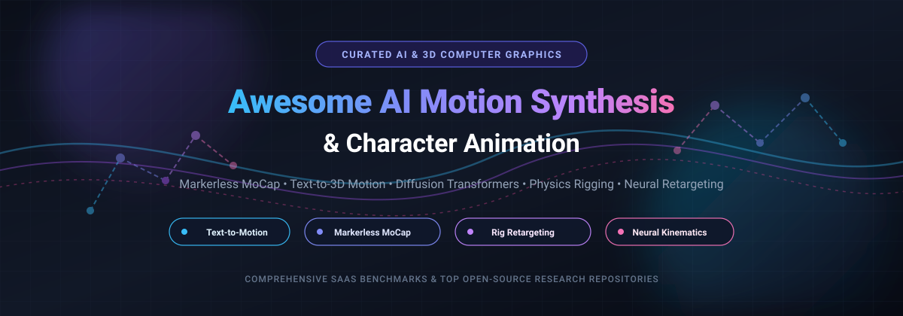

# Awesome AI Motion Synthesis & Animation 🚀✨

 

  <b>A curated catalog of leading SaaS platforms and state-of-the-art open-source projects for AI Motion Synthesis, Markerless Motion Capture (MoCap), Text-to-3D Motion, Neural Character Animation, and Kinematic Retargeting.</b>

---

## 📖 Table of Contents 📌

- [🌟 Introduction & SEO Overview](#-introduction--seo-overview)
- [📊 Sector Overview & Market Dynamics](#-sector-overview--market-dynamics)
- [💼 SaaS & Hosted Commercial Platforms](#-saas--hosted-commercial-platforms)
- [🔓 Open-Source GitHub Projects](#-open-source-github-projects)
- [📈 Star History](#-star-history)
- [🤝 How to Contribute](#-how-to-contribute)
- [💖 Support](#-support)
- [⚖️ Disclaimer](#️-disclaimer)

---

## 🌟 Introduction & SEO Overview 🔍

Welcome to the definitive repository for **AI Motion Synthesis, AI Character Animation, and Markerless Motion Capture (MoCap)**. The convergence of generative AI, deep reinforcement learning, and 3D computer vision is revolutionizing computer graphics (CG), VFX production, video game development, and spatial computing.

Whether you are looking for enterprise-grade text-to-animation suites, cloud video-to-mocap pipelines, diffusion transformers (`DiT`), SMPL/SMPL-X parametric mesh recovery, or programmatic motion design frameworks (such as Remotion and Motion Canvas), this curated guide covers both market-leading commercial platforms and groundbreaking open-source research codebases.

---

## 📊 Sector Overview & Market Dynamics 📈

The global market for **AI Motion Capture and Generative AI Animation** is valued at approximately **$1.6B – $2.6B in 2025–2026** (with 3D motion capture accounting for ~$320M–$390M growing at ~13% CAGR, and generative AI animation software reaching ~$1.3B–$2.2B surging at an explosive ~30–39% CAGR toward multi-billion-dollar scale by 2032). 

The industry demonstrates a **moderately fragmented market structure**: legacy computer graphics and CAD giants (such as Adobe and Autodesk) command immense foundational scale and ecosystem gravity, while specialized venture-backed startups and agile research teams (Move.ai, DeepMotion, Cascadeur, Rokoko) fiercely contest high-performance niches including markerless multi-camera reconstruction, real-time physics-assisted posing, and browser-native neural mocap.

---

## 💼 SaaS & Hosted Commercial Platforms 🏢

*Ranked by company scale (market capitalization, enterprise valuation, or total venture funding/revenue in descending order).*

| Company / Product | Category & Core Focus | Company Size (Valuation / Market Cap / Funding) | Pricing (Starting Tier) | Free Tier & Free Trial Limits |
| :--- | :--- | :--- | :--- | :--- |
| **[Adobe Mixamo](https://mixamo.com)** | 3D Auto-Rigging & Animation Library | **~$88B – $95B Market Cap** (Adobe Inc., NASDAQ: ADBE) | **$0.00** (Included with Adobe Account) | **100% Free Forever** (Requires a free Adobe ID; unlimited royalty-free character auto-rigging and animation downloads for commercial & personal projects). |
| **[Wonder Dynamics (Autodesk Flow Studio)](https://wonderdynamics.com)** | AI Video-to-VFX & CG Character MoCap | **~$53B – $56B Market Cap** (Parent: Autodesk, NASDAQ: ADSK) | **$10.00 / mo** (Lite Tier, billed annually) | **Permanent Free Tier** (300 credits/mo = ~15s video rendering or ~30s AI mocap, 1 GB storage, 720p watermarked output, non-commercial use). |
| **[Rokoko Studio & Rokoko Video](https://rokoko.com)** | Single/Dual Camera AI MoCap & Studio Suite | **>$80M Valuation** (~$18M Venture Funded) | **$10.00 / mo** ($120/yr Basic Plan) | **Permanent Free Plan (Starter: $0)** (30s video mocap processing/mo via Vision AI, unlimited text-to-motion generation with 5 Studio imports/mo, FBX export, 1 month cloud storage). |
| **[Anything World (AnyWorld)](https://anything.world)** | AI 3D Model Generation & Auto-Rigging | **~$9.3M Total Funding** (Series Seed Plus / Series A) | **$30.00 / mo** (Nano Plan) | **Permanent Free Tier (Individual: $0)** (15 credits/mo to generate, auto-rig, and animate 3D models; includes 1 model download per month). |
| **[Plask Motion](https://plask.ai)** | Browser-Based AI MoCap & Keyframe Studio | **~$2.56M Funding** (Pre-Series A) | **$18.00 / mo** (Standard, billed annually) | **Permanent Free Tier (Freemium: $0)** (15 seconds of AI motion capture per day, 1 GB cloud storage, standard FBX/GLB/BVH export, personal non-commercial license). |
| **[DeepMotion](https://deepmotion.com)** | Cloud Markerless MoCap & Physics Simulation | **~$2.2M Funding + Strategic** (Bandai Namco, Samsung Ventures) | **$9.00 / mo** ($108/yr Starter Plan) | **Permanent Free Plan (Freemium: $0)** (3 animation credits/mo = ~60s processing, max 10s clip length, 1 download/mo, lowest queue priority, non-commercial license; earn back credits via model labeling). |
| **[Move.ai (Move One)](https://move.ai)** | Single/Multi-Cam AI Markerless Motion Capture | **~$1.5M – £34.8M Peak** (£1.1M Rev; Acquired by Oxford Metrics / Vicon) | **$18.00 / mo** (Starter Tier, 60 credits/mo) | **Free Signup Allocation** (One-time allotment of 30 free credits that do not expire, max 30-second video recording/processing clip length; no recurring monthly reset without active subscription). |
| **[Cascadeur](https://cascadeur.com)** | Physics-Assisted AI Keyframe Animation | **~$1.5M Dedicated Scale** (Nekki Internal Ecosystem) | **$19.00 / mo** ($96/yr Indie Tier) | **Permanent Free Tier ($0)** (Full AI AutoPosing and AutoPhysics toolset, non-commercial use; project saves restricted to proprietary `.casc` format with standard FBX/DAE/USD exports locked to paid tiers). |
| **[Kinetix](https://kinetix.tech)** | AI Motion SDK & In-Game Emote Generation | **Private / VC-Backed Lab** (Early-Stage B2B Provider) | **Custom B2B / €0.15 per emote** (SDK Integration) | **Free Developer Sandbox Tier** (Indie developers receive up to 10,000 free emote generation credits for initial testing and SDK integration prior to metered billing). |
| **[RADiCAL Motion](https://radicalmotion.com)** | Real-Time Browser 3D Pose Estimation | **Legacy Acquisition / Winding Down** (Core IP Acquired by Autodesk) | **Historical: ~$8.00 / mo** (Service Transitioned) | **Platform Shut Down / Historical Archive** (Previously offered 15 min/mo motion playtime free tier; web portal now sunset following Autodesk IP acquisition). |

---

## 🔓 Open-Source GitHub Projects 💻

*Curated list of 37 state-of-the-art open-source repositories for text-to-motion generation, markerless motion capture, human mesh recovery (HMR), parametric body modeling, and programmatic animation, sorted in descending order by GitHub star count.*

- **[Remotion (`remotion-dev/remotion`)](https://github.com/remotion-dev/remotion)**   
  Leading open-source TypeScript and React framework for programmatic motion synthesis, video creation, and kinetic typography.

- **[Motion Canvas (`motion-canvas/motion-canvas`)](https://github.com/motion-canvas/motion-canvas)**   
  Open-source (`MIT`) TypeScript library and visual editor for programmatic vector animations, interactive motion design, and algorithmic visual explainer videos.

- **[LivePortrait (`KwaiVGI/LivePortrait`)](https://github.com/KwaiVGI/LivePortrait)**   
  Fast, open-source (`MIT`) portrait and character facial motion synthesis engine featuring stitching and retargeting controls for expressive eyes, lips, and head movement.

- **[Wan2.1 (`Wan-Video/Wan2.1`)](https://github.com/Wan-Video/Wan2.1)**   
  Comprehensive open-source video generative foundation model suite capable of high-fidelity cinematic video generation and dynamic motion synthesis across text-to-video and image-to-video.

- **[AnimateDiff (`guoyww/AnimateDiff`)](https://github.com/guoyww/AnimateDiff)**   
  Pioneering open-source text-to-video motion synthesis framework that animates personalized text-to-image diffusion models without additional per-model tuning.

- **[FreeMoCap (`freemocap/freemocap`)](https://github.com/freemocap/freemocap)**   
  Free, hardware-agnostic open-source (`AGPL-3.0`) multi-camera markerless motion capture system delivering research-grade 3D full-body, hand, and face tracking locally.

- **[EasyMocap (`zju3dv/EasyMocap`)](https://github.com/zju3dv/EasyMocap)**   
  Comprehensive open-source 3D computer vision toolbox for single/multi-person markerless motion capture and SMPL/SMPL-X/MANO parametric body recovery from RGB videos.

- **[Champ (`fudan-generative-vision/champ`)](https://github.com/fudan-generative-vision/champ)**   
  Controllable and consistent human video and motion synthesis framework using 3D parametric guidance (SMPL) with latent diffusion models.

- **[Human Motion Diffusion Model / MDM (`GuyTevet/motion-diffusion-model`)](https://github.com/GuyTevet/motion-diffusion-model)**   
  Foundational open-source (`MIT`) text-to-motion diffusion framework synthesizing diverse, high-fidelity 3D human motion sequences and spatial trajectory edits (`PriorMDM`).

- **[Mesh2Motion (`scottpetrovic/mesh2motion-app`)](https://github.com/scottpetrovic/mesh2motion-app)**   
  Free, open-source (`MIT`) browser and desktop Mixamo alternative offering automated skeletal rigging, weight painting, and 40+ pre-built animations for humans, quadrupeds, and creatures.

- **[Moore-AnimateAnyone (`MooreThreads/Moore-AnimateAnyone`)](https://github.com/MooreThreads/Moore-AnimateAnyone)**   
  High-fidelity character image animation and motion transfer framework conditioned on pose sequences with spatial attention and temporal layers.

- **[DynamiCrafter (`Doubiiu/DynamiCrafter`)](https://github.com/Doubiiu/DynamiCrafter)**   
  Open-source generative framework animating open-domain still images into dynamic motion sequences with rich dynamic visual priors.

- **[alchaincyf/huashu-motion](https://github.com/alchaincyf/huashu-motion)**   
  Open-source AI motion synthesis and animation skill toolkit engineered for generating structured, visually polished motion design, kinetic transitions, and animated workflows.

- **[DWPose (`IDEA-Research/DWPose`)](https://github.com/IDEA-Research/DWPose)**   
  State-of-the-art whole-body pose and motion estimation method widely adopted as the driving pose detector across AI character motion transfer pipelines.

- **[SMPL-X (`vchoutas/smplx`)](https://github.com/vchoutas/smplx)**   
  Expressive 3D human body, hand, and facial parametric model repository fundamental to AI 3D motion capture, estimation, and kinematic synthesis.

- **[MimicMotion (`Tencent/MimicMotion`)](https://github.com/Tencent/MimicMotion)**   
  Open-source high-resolution human motion transfer framework using confidence-aware pose guidance to animate any character image cleanly from driving videos.

- **[HY-Motion 1.0 (`Tencent-Hunyuan/HY-Motion-1.0`)](https://github.com/Tencent-Hunyuan/HY-Motion-1.0)**   
  Flagship open-source Diffusion Transformer and flow-matching model generating natural, physically plausible 3D character skeletal animations from text prompts across sports, combat, and daily actions.

- **[GVHMR (`zju3dv/GVHMR`)](https://github.com/zju3dv/GVHMR)**   
  Open-source monocular 3D human motion estimation model operating in a gravity-view coordinate system for stable, drift-free world-space skeletal animations.

- **[SMPLify-X (`vchoutas/smplify-x`)](https://github.com/vchoutas/smplify-x)**   
  Expressive 3D human body and motion capture fitting method capturing body pose, hands, and facial expression from a single RGB image.

- **[Motion2MixamoRig (`MaxLiu22/Motion2MixamoRig`)](https://github.com/MaxLiu22/Motion2MixamoRig)**   
  Automated pipeline to extract 3D human motion from standard video and retarget directly onto standard Mixamo skeletal rigs for Blender and game engines.

- **[4D-Humans (`shubham-goel/4D-Humans`)](https://github.com/shubham-goel/4D-Humans)**   
  State-of-the-art monocular 3D human pose, shape, and motion tracking from video using the HMR 2.0 transformer model.

- **[HMR (`akanazawa/hmr`)](https://github.com/akanazawa/hmr)**   
  Pioneering end-to-end framework for recovering 3D human mesh and pose from a single RGB image without intermediate 2D keypoints.

- **[HumanML3D (`EricGuo5513/HumanML3D`)](https://github.com/EricGuo5513/HumanML3D)**   
  Widely adopted benchmark and dataset toolkit connecting 3D human motion sequences with expressive 3D natural language annotations.

- **[ROMP (`Arthur151/ROMP`)](https://github.com/Arthur151/ROMP)**   
  Real-time monocular multi-person 3D mesh recovery and kinematic motion tracking under severe occlusion in complex environments.

- **[MotionBERT (`Walter0807/MotionBERT`)](https://github.com/Walter0807/MotionBERT)**   
  Unified pre-trained motion representation framework for 3D human motion estimation, action recognition, and mesh recovery from monocular RGB video.

- **[MoMask (`EricGuo5513/momask-codes`)](https://github.com/EricGuo5513/momask-codes)**   
  Generative masked modeling framework for high-fidelity 3D human motion generation and language-guided spatial motion inpainting.

- **[WHAM (`yohanshin/WHAM`)](https://github.com/yohanshin/WHAM)**   
  Open-source monocular video-to-3D human motion recovery method reconstructing globally accurate 3D trajectories and SMPL meshes in world coordinates rather than camera space.

- **[AMASS (`nghorbani/amass`)](https://github.com/nghorbani/amass)**   
  Archive of Motion Capture as Surface Shapes: standard open-source library and unified representation unifying multiple optical motion capture datasets.

- **[MotionDiffuse (`mingyuan-zhang/MotionDiffuse`)](https://github.com/mingyuan-zhang/MotionDiffuse)**   
  Open-source (`S-Lab`) text-driven human motion generation framework supporting multi-level text descriptions, body-part-level control, and arbitrary-length motion synthesis.

- **[Pose2Sim (`perfanalytics/pose2sim`)](https://github.com/perfanalytics/pose2sim)**   
  Open-source markerless kinematics pipeline translating 2D video pose tracking into validated 3D skeletal and musculoskeletal joint angles via OpenSim.

- **[T2M-GPT (`Mael-zys/T2M-GPT`)](https://github.com/Mael-zys/T2M-GPT)**   
  Open-source (`MIT`) VQ-VAE and Generative Pre-trained Transformer architecture for generating high-accuracy 3D human motion sequences from natural-language descriptions.

- **[fairmotion (`facebookresearch/fairmotion`)](https://github.com/facebookresearch/fairmotion)**   
  Open-source platform by Meta AI Research for loading, processing, visualizing, and training deep learning models on 3D motion capture data.

- **[prompt2rig (`blendi-remade/prompt2rig`)](https://github.com/blendi-remade/prompt2rig)**   
  Open-source (`Apache-2.0`) prompt-to-3D-animation pipeline that synthesizes motion clips, extracts 3D body (`GVHMR`) and 15-joint finger (`WiLoR`) kinematics locally, and exports rigged `.glb` animations.

- **[MotionLCM (`Dai-Wenxun/MotionLCM`)](https://github.com/Dai-Wenxun/MotionLCM)**   
  Real-time latent consistency model for text-driven 3D human motion generation and real-time motion control in as few as 2-4 inference steps.

- **[OpenCap Monocular (`utahmobl/opencap-monocular`)](https://github.com/utahmobl/opencap-monocular)**   
  Open-source single-camera AI framework estimating accurate 3D joint kinematics and ground reaction forces without laboratory mocap hardware.

- **[BlendCap (`Arcomade/BlendCap`)](https://github.com/Arcomade/BlendCap)**   
  Open-source single-camera AI video performance capture and automated skeletal animation retargeting tool inside Blender.

- **[vid2anim (`mehulcode12/vid2anim`)](https://github.com/mehulcode12/vid2anim)**   
  Open-source (`MIT`) AI motion capture and universal character retargeting studio with a Blender add-on supporting Mixamo, VRM, Rigify, and Unreal Engine Mannequins.

---
## 📈 Star History 📊

---

## 🤝 How to Contribute 🛠️

Contributions are welcome! Please follow these guidelines:

1. 🍴 Fork the repository.
2. 🌿 Create a new feature branch (git checkout -b feature/add-motion-tool).
3. 📝 Add or update entries in README.md adhering to the table format for SaaS or list format for Open-Source projects.
4. 🔗 Include accurate project names, direct links, GitHub star badges, verified pricing, and factual descriptions.
5. 🚀 Open a well-documented Pull Request!

---

## 💖 Support ☕

If you found this curated ecosystem directory useful, please consider supporting the project:

- ⭐ **Star this repository** to help others discover it!
- 🍴 **Fork and share** with colleagues, animators, and researchers.
- ☕ **Buy me a coffee**: Sponsor ongoing open-source curation and development via the [GitHub Sponsor Dashboard](https://github.com/sponsors/ishandutta2007).

Thank you for being part of the open AI motion community! ❤️

---

## ⚖️ Disclaimer 🛡️

All product names, logos, brands, and registered trademarks belong to their respective owners. Company names, products, valuations, and service pricing featured in this repository are for informational, comparative, and educational purposes only.
